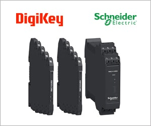
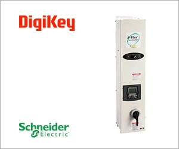
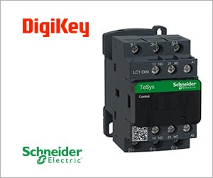
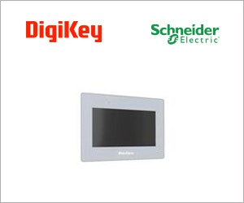
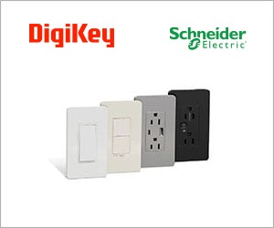
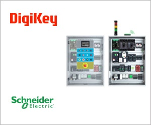

# کالبدشکافی فنی نوآوری‌های اتوماسیون صنعتی اشنایدر الکتریک در خبرنامه Machine Design: مبدل‌های آنالوگ ایزوله، درایوهای هوشمند با مدار بای‌پَس، کنتاکتورهای سنگین و معماری تابلوهای کنترل نسل جدید


> **منبع اصلی:** خبرنامه بین‌المللی *Machine Design Product Spotlight* (تاریخ ۲۹ اکتبر ۲۰۲۶)  
> **حامی مالی و توزیع‌کننده تخصصی:** کمپانی بین‌المللی DigiKey به همراه کمپانی Schneider Electric  
> **ترجمه تخصصی، بومی‌سازی و تحلیل مهندسی:** مهندس حسین وطن‌دوست | دپارتمان تحقیق و توسعه ماشین دیزاین (`MachineDesign.ir`)  
> **دسته‌بندی و حوزه مهندسی:** اتوماسیون صنعتی، درایوها و تابلوهای کنترل (`automation-control`)  

---

## ۱. مقدمه: گلوگاه‌های زیرساختی در برق، درایو و اتوماسیون خطوط تولید صنعتی


در طراحی ماشین‌آلات صنعتی مدرن، خطوط بسته‌بندی، ایستگاه‌های فرآوری مواد غذایی و سیستم‌های تاسیساتی کارخانجات، تابلوهای برق و سیستم‌های کنترل قلب تپنده خط به شمار می‌روند. با این حال، مهندسان طراح مکاترونیک و مدیران فنی تاسیسات به طور مداوم با ۴ چالش زیرساختی دست‌وپنجه نرم می‌کنند:

1. **نویزهای الکترومغناطیسی شدید (EMI/RFI) و خطاهای حلقه‌زمین (Ground Loops):** عبور کابل‌های سنسورهای حساس آنالوگ (نظیر ترموکوپل‌ها، لودسل‌ها و ترانسمیترهای فشار) از کنار کابل‌های قدرت اینورترها، اعوجاج شدیدی در کارت‌های ورودی PLC ایجاد کرده و دقت فرآیند را مختل می‌کند.
2. **توقف کامل خط تولید (Downtime) در صورت خرابی اینورتر:** در پمپ‌ها و فن‌های بحرانی فرآیندی، ایجاد یک آلارم یا خطای داخلی در اینورتر (VFD) به معنای متوقف شدن کل خط خنک‌کاری یا تخلیه هوا تا زمان عیب‌یابی و تعمیر درایو است.
3. **شل‌شدن اتصالات پیچ و ترمینال‌ها در اثر ارتعاش مداوم ماشین:** شوک‌ها و ارتعاشات دینامیکی ناشی از ضربات پرس‌ها، سرندها و کمپرسورها به مرور زمان باعث شل شدن پیچ‌های کنتاکتورها و کابل‌شوها، افزایش مقاومت تماسی ($R_{\text{contact}}$)، داغ شدن بیش از حد (Overheating) و در نهایت سوختن کنتاکتور یا آتش‌سوزی در تابلو می‌شود.
4. **ناهمگونی پروتکل‌های شبکه صنعتی و مانیتورینگ دشوار:** تنوع سازندگان PLC در خطوط ترکیبی (زیمنس، امرن، میتسوبیشی، اشنایدر) مانیتورینگ متمرکز و اتصال نمایشگرهای لمسی اپراتوری (HMI) را به کابوسی پرهزینه تبدیل کرده است.

خبرنامه تخصصی **Product Spotlight** نشریه معتبر بین‌المللی *Machine Design* (نسخه ۲۹ اکتبر ۲۰۲۶) با تمرکز بر سبد محصولات اتوماسیون صنعتی **Schneider Electric** با پشتیبانی و عرضه جهانی **DigiKey**، مجموعه‌ای از راهکارهای مدولار و آزموده شده را برای ریشه‌کنی این مشکلات معرفی نموده است. در این تحلیل فنی، این تجهیزات را از منظر مهندسی مکانیک، مکاترونیک و نگهداری و تعمیرات کالبدشکافی می‌کنیم.

---

## ۲. مبدل‌ها و ترانسمیترهای سیگنال آنالوگ Harmony™: ایزولاسیون گالوانیک و تصفیه سیگنال در سالن‌های صنعتی



در محیط‌های خشن صنعتی، سنسورهای اندازه‌گیری دما، فشار، جریان سیال و لودسل‌ها در فواصلی دور از تابلوی مرکزی نصب می‌شوند. انتقال مستقیم ولتاژهای میلی‌ولتی ناشی از ترموکوپل‌ها بر روی کابل‌های طویل، مستعد جذب نویزهای القایی، اختلاف پتانسیل زمین میان بخش‌های مختلف کارخانه و ایجاد پدیده **Ground Loop** است که می‌تواند کارت‌های گران‌قیمت ورودی آنالوگ PLC را منهدم کند.

خانواده ترانسمیترها و مبدل‌های آنالوگ **Schneider Electric Harmony™ Analog** جهت کاندیشنینگ (Signal Conditioning)، تقویت و ایزولاسیون کامل سیگنال‌ها طراحی شده‌اند:

### مشخصات و قابلیت‌های کلیدی مهندسی:
* **ایزولاسیون گالوانیک سه‌طرفه (3-Way Galvanic Isolation):** ایجاد سد عایقی دی‌الکتریک تا ولتاژ **$2.5\text{ kV}$** بین ورودی (Input)، خروجی (Output) و منبع تغذیه (Power Supply)، که انتقال هرگونه ولتاژ گذرا، اسپایک و جریان سرگردان را ناممکن می‌سازد.
* **پوشش کامل انواع سنسورهای فرآیندی:**
  * ورودی‌های دمایی ترموکوپل تیپ‌های J و K با جبران‌سازی اتصال سرد (Cold Junction Compensation).
  * ورودی‌های مقاومتی سنسورهای دمای RTD شامل $Pt100$ و $Pt1000$ در پیکربندی‌های ۲، ۳ و ۴ سیمه جهت حذف مقاومت ذاتی کابل رابط.
  * ترانسمیترهای اندازه‌گیری ولتاژ و جریان متناوب/مستقیم (AC/DC Current & Voltage Transducers) برای پایش توان موتورها.
* **تبدیل به خروجی‌های استاندارد کالیبره‌شده:** تبدیل مقادیر متغیر به لوپ‌های استاندارد **$4-20\text{ mA}$** (مقاوم در برابر افت ولتاژ طول کابل و نویز) یا ولتاژ **$0-10\text{ V}$**.
* **طراحی باریک و نصب ریلی DIN-Rail:** با عرض باریک (Compact Slimline) که اشغال فضا بر روی ریل تابلوی برق را به حداقل می‌رساند.

### فرمول‌بندی مهندسی تضعیف نویز و رابطه تبدیل خطی:
در یک ترانسمیتر دمایی $Pt100$ با محدوده کاری دمایی $T_{\min}$ تا $T_{\max}$، جریان خروجی $I_{\text{out}}$ (بر حسب $\text{mA}$) بر مبنای دمای لحظه‌ای فرآیند ($T$) از رابطه خطی زیر به دست می‌آید:
$$I_{\text{out}} = 4\text{ mA} + \left( \frac{T - T_{\min}}{T_{\max} - T_{\min}} \right) \times 16\text{ mA}$$

تجهیز این مبدل‌ها به فیلترهای پایین‌گذر اکتیو داخلی (Active Low-Pass Filtering) سبب می‌شود که نویزهای فرکانس بالای ناشی از سوئیچینگ IGBTهای درایوهای مجاور (Carrier Frequency معمولاً بین ۲ تا ۱۶ کیلوهرتز) با ضریب تضعیف بیش از **$60\text{ dB}$** فیلتر شوند و سیگنالی کاملاً هموار و پایدار به پردازنده خط برسد.

---

## ۳. درایوهای فرکانس متغیر محصور شده S-Flex™ SFD212: تداوم کارکرد با مدار بای‌پَس هوشمند و راندمان سیالات



کنترل پمپ‌های سیرکولاسیون، برج‌های خنک‌کن، دمنده‌های کوره و فن‌های هوارسان در کارخانجات بدون کنترل دور متغیر، مصادف با اتلاف عظیم انرژی الکتریکی و تنش‌های شدید هیدرولیکی است. درایوهای سنتی فاقد کابینت محافظ، نیازمند طراحی پیچیده تابلو، جانمایی کلیدهای مینیاتوری، کنتاکتورهای مجزا و مدارهای ایزولاسیون در محل کارگاه بودند.

کمپانی اشنایدر الکتریک با عرضه سری **S-Flex™ SFD212 Enclosed VFD** که از پردازنده و الگوریتم‌های درایو نام‌آشنای **Altivar™ 212** بهره می‌برد، یک پکیج آماده نصب و یکپارچه صنعتی ارائه داده است:

### معماری بای‌پَس هوشمند (Smart Bypass Architecture) و قابلیت اطمینان:
بزرگ‌ترین مزیت مهندسی سری S-Flex، مدار **بای‌پَس داخلی (Mechanical / Electronic Bypass)** است:
* در حالت کارکرد عادی، الکتروموتور با فرکانس متغیر کنترل شده و مصرف انرژی بهینه‌سازی می‌شود.
* در صورت بروز خطای داخلی در اینورتر (مانند اضافه ولتاژ شبکه، خطای دمایی یا خرابی فن خنک‌کننده درایو) یا هنگام نیاز به تعمیرات دوره‌ای، سیستم کنترل به طور خودکار یا دستی از طریق یک سوئیچ ارگونومیک بر روی درب، موتور را بدون توقف روی خط برق مستقیم سراسری (Direct-on-Line - DOL) سوئیچ می‌کند.
* این قابلیت، توقفات خط تولید (Production Downtime) را در فرآیندهای حساس دارویی، غذایی و پتروشیمی به **صفر مطلق** می‌رساند.

### انطباق با قوانین تشابه سیالات (Affinity Laws) و صرفه‌جویی انرژی:
بر اساس قوانین فیزیکی حاکم بر توربوماشین‌ها و پمپ‌های گریز از مرکز (Affinity Laws)، توان مصرفی الکتروپمپ ($P$) با توان سوم دور چرخش پروانه ($n$) متناسب است:
$$\frac{P_1}{P_2} = \left(\frac{n_1}{n_2}\right)^3$$

این رابطه بدین معناست که تنها با **۲۰ درصد کاهش دور فن یا پمپ** ($n_2 = 0.8\, n_1$)، توان مصرفی الکتریکی به میزان **تقریباً ۵۰ درصد** کاهش می‌یابد:
$$P_2 = (0.8)^3 \times P_1 = 0.512 \times P_1$$

### ادغام بومی با پروتکل‌های مدیریت ساختمان و تاسیسات (BAS Integration):
این درایو مجهز به کارت‌های ارتباطی بومی برای ادغام بدون واسطه با شبکه‌های **Modbus**، **BACnet MS/TP**، **Apogee FLN** و **LonWorks** است که نیاز به ماژول‌های مبدل گران‌قیمت خارجی را از میان برمی‌دارد. همچنین فیلترهای کاهش اعوجاج هارمونیکی داخلی (THDi < 30%) تلفات حرارتی ترانسفورماتورهای توزیع کارخانه را مهار می‌کنند.

---

## ۴. کنتاکتورهای صنعتی سنگین TeSys™ Deca: اتصالات ضد شل‌شدگی EverLink و طول عمر استثنایی



در خطوط بسته‌بندی پرسرعت، نوار نقاله‌های رفت‌وبرگشتی، خردکن‌ها و مکانیزم‌های صنعتی، کنتاکتورهای فرمان موتورها با بارهای شدید القایی (Inductive Inrush Currents) معادل ۶ تا ۸ برابر جریان نامی موتور در لحظه استارت مواجه هستند. علاوه بر این، ارتعاشات ارتعاش‌سازهای صنعتی موجب کاهش تدریجی نیروی کلمپ پیچ‌ها در پایانه‌های سنتی می‌شود.

سری کنتاکتورهای **TeSys™ Deca** (تکامل‌یافته سری افسانه‌ای TeSys D) به عنوان استاندارد جهانی راه‌اندازی و سوئیچینگ الکتروموتورها شناخته می‌شوند:

### مشخصات توان و رده‌های کاری:
* **جریان‌دهی تا ۱۵۰ آمپر در رده AC-3:** سوئیچینگ و قطع جریان قفل‌شده موتورهای قفس سنجابی تحت بار سنگین.
* **جریان‌دهی تا ۲۰۰ آمپر در رده AC-1:** تغذیه و قطع بارهای اهمی و حرارتی خالص نظیر المنت‌های کوره‌های صنعتی و خطوط سیلینگ حرارتی بسته‌بندی.
* **طول عمر مکانیکی و الکتریکی:** تا **۱.۵ میلیون سیکل کاری** در بار کامل AC-3 و بیش از **۱۵ میلیون سیکل مکانیکی** بدون افت خواص پلاتین‌ها.

### فناوری انحصاری پایانه‌های EverLink™ (مکانیزم جبران خزش کابل):
بزرگ‌ترین معضل تابلوهای برق در مجاورت ماشین‌آلات ارتعاشی، پدیده **خزش مس کابل (Copper Creep)** در زیر پیچ ترمینال است. فناوری اختراعی **EverLink™** در کنتاکتورهای TeSys Deca از یک ساختار فنری انعطاف‌پذیر به همراه قفسه کلمپ پیشرفته استفاده می‌کند:
* حتی در صورت افت ضخامت مس ناشی از خزش یا ارتعاشات مداوم فرکانس بالای ماشین، کشش الاستیک فنر داخلی فشار تماس دائمی را حفظ می‌کند.
* این نوآوری نیاز به آچارکشی دوره‌ای سالیانه در تابلوهای برق را برطرف کرده و خطر داغ شدن نقطه اتصال و آتش‌سوزی الکتریکی را از بین می‌برد.

### جدول مقایسه مشخصات فنی رده‌های باری کنتاکتور TeSys Deca:

| رده کاربری بار (Utilization Category) | جریان نامی پیوسته ($I_e$) | نوع بار و مکانیزم متصل | پدیده بحرانی حین قطع و وصل | فناوری مقابله در TeSys Deca |
| :--- | :--- | :--- | :--- | :--- |
| **AC-3 (موتورهای آسنکرون استاندارد)** | تا ۱۵۰ آمپر | کانوایرها، پمپ‌های اسلاری، گیربکس‌های صنعتی | جریان هجومی اولیه ($6-8 \times I_n$) و جرقه بازگشتی سلفی | پلاتین‌های آلیاژ نقره-اکسید کادمیوم / قلع با خاموش‌کننده جرقه قوسی |
| **AC-1 (بارهای مقاومتی بدون سلف)** | تا ۲۰۰ آمپر | المنت‌های پخت حرارتی، هیترهای فرمینگ پلاستیک | حرارت پیوسته بالا در باس‌بارها و ترمینال‌ها | بدنه ضد حریق با اتصالات خنک‌شونده EverLink |
| **AC-4 (کاربری سنگین، ترمز و اینچینگ)** | تا ۸۰ آمپر | جرثقیل‌ها، فیدرهای ضربه‌ای، رولیک‌های معکوس‌شونده | قطع جریان قفل در دور صفر با ولتاژ بازگشتی فوق‌العاده بالا | مقاومت دی‌الکتریک تقویت‌شده و فاصله هوایی افزایش‌یافته |

---

## ۵. نمایشگرهای لمسی اپراتوری صنعتی Pro-face™: مقاومت محیطی و اتصال به شبکه‌های ناهمگن



در سطح اتوماسیون کارگاهی، اپراتور نیاز به رابطی مقاوم و قابل درک جهت پایش متغیرهای فرآیند، تغییر دستورالعمل‌های تولید (Recipe Management) و مشاهده هشدارهای خط دارد. برند ژاپنی-فرانسوی **Pro-face** (زیرمجموعه تخصصی اشنایدر الکتریک) دهه‌هاست به عنوان مرجع شماره یک پنل‌های اپراتوری HMI در خطوط تولید جهان شناخته می‌شود.

### اتصال هم‌زمان به چند PLC ناهمگن (Multi-Protocol Gateway):
معمولاً در کارخانجات، ماشین‌های مختلف دارای کنترلرهای متفاوتی هستند: یک دستگاه مجهز به زیمنس S7-1500، دستگاه دیگر مجهز به آلن بردلی ControlLogix و دستگاه بسته‌بندی مجهز به امرن یا اشنایدر است. پنل‌های Pro-face قابلیت بی‌نظیر زیر را دارا هستند:
* ارتباط هم‌زمان از طریق درگاه‌های اترنت و سریال مستقل با چندین برند مختلف کنترلر بدون نیاز به ماژول واسط سخت‌افزاری.
* پشتیبانی بومی از پروتکل‌های بنیادین نسل چهارم صنعت:
  * **OPC-UA (Client & Server):** استاندارد امن ارتباط ماشین با ماشین (M2M) و انتقال داده به سرورهای ابری و سیستم‌های SCADA/MES.
  * **Modbus TCP/IP & Modbus RTU:** ارتباط ساده و پایدار با سنسورها و درایوها.
  * **EtherNet/IP:** شبکه بلادرنگ صنعتی برای هماهنگی با ربات‌ها و درایوهای سرعت‌بالا.

### استحکام مکانیکی و استاندارد حفاظتی بدنه:
* پنل جلویی دارای استاندارد حفاظتی **IP65F / IP67** مقاوم در برابر پاشش فشار بالای آب، بخارات شیمیایی و روغن‌های صنعتی خنک‌کاری (Coolants).
* صفحه لمسی صنعتی مقاوم در برابر خط‌وخش با قابلیت کارکرد حتی با دستکش‌های ضخیم کارگری.
* ثبت لاگ رویدادها بر روی کارت حافظه SD و سرور شبکه جهت ریشه‌یابی خطاهای توقف خط در سیستم‌های نگهداری و تعمیرات پیشگیرانه (PM).

---

## ۶. تجهیزات وایرینگ سری X و معماری جامع تابلوهای کنترل هوشمند

````carousel

<!-- slide -->

````

شعارهای راهبردی اشنایدر در این خبرنامه دو محور اساسی دارند:  
1. **"X Series Wiring Devices:"** ادغام زیبایی، استحکام ضدضربه و پروتکل باز **Matter** برای تجهیزات تاسیساتی سبک کارخانه‌ها و فضاهای اداری صنعتی.
2. **"Design Smart, Build Fast, Run Efficiently:"** دگرگونی فرآیند طراحی و ساخت تابلوهای کنترل صنعتی.

### مهندسی ساخت تابلوهای برق فشرده بر مبنای اصول DFMA:
در فرآیند سنتی ساخت تابلو برق (Panel Building)، حجم زیادی از سیم‌کشی‌ها، کانال‌های سیم (Ducts) و هدررفت حرارتی باعث بزرگ شدن ابعاد فیزیکی کابینت‌ها می‌شد. با متدولوژی جامع اشنایدر:
* **کاهش تا ۳۵ درصدی ابعاد بیرونی تابلو:** ادغام تجهیزات کامپکت، چیدمان بهینه مسیر جریان هوای خنک‌کننده طبیعی و استفاده از باس‌بارهای یکپارچه به جای کابل‌کشی‌های متقاطع.
* **کاهش ۴۰ درصدی زمان مونتاژ و سیم‌کشی:** استفاده گسترده از ترمینال‌های فشاری بدون پیچ (**Push-In Spring Terminals**) که سرعت اتصال سیم‌ها را نسبت به ترمینال‌های پیچی تا بیش از دو برابر افزایش می‌دهد.
* **تعمیرپذیری و تست سریع:** تمامی تجهیزات دارای پورت‌های دسترسی مستقیم تستر و ماژول‌های جداشونده هستند که عیب‌یابی در محل کارخانه را شتاب می‌بخشد.

---

## ۷. تحلیل پیوند با ۶ ستون خدمات ماشین دیزاین (`MachineDesign.ir`)

تحلیل عمیق این تجهیزات و نوآوری‌ها در تابلوسازی و درایوهای صنعتی مستقیماً در راستای اهداف عملیاتی **۶ ستون خدمات ماشین دیزاین** قرار دارد:

```
[ستون ۱: طراحی ماشین‌آلات و خطوط تولید]
├── استانداردسازی تابلوهای کنترل بر اساس ابعاد بهینه و ماژول‌های Push-in (کاهش فضای تابلو تا ۳۵٪)
└── انتخاب درایوهای مجهز به پروتکل‌های باز (Modbus/EtherNet/IP) جهت هماهنگی سرعت خطوط نوار نقاله و پمپ‌ها

[ستون ۲: مشاوره فنی و حل مسئله کارخانه‌ها]
├── حذف خاموشی‌های فاجعه‌بار با مدار بای‌پَس هوشمند درایوهای S-Flex (تداوم تولید در زمان سرویس درایو)
├── حذف خطای سنسورهای دمایی و لودسل‌ها با مبدل‌های ایزوله Harmony (حذف نویز EMI و Ground Loops)
└── پیشگیری از آتش‌سوزی تابلو و داغ‌شدن پلاتین‌ها با اتصالات ضد خزش EverLink در کنتاکتورهای TeSys

[ستون ۳: تحقیق، توسعه سازمانی و R&D]
└── ادغام پنل‌های لمسی Pro-face به عنوان درگاه‌های لبه (Edge Gateways) با پروتکل امن OPC-UA جهت اتصال کارخانه به داشبوردهای هوش تجاری
```

### ماتریس تطبیق عیوب رایج کارخانجات و راهکار فناورانه:

| گلوگاه یا خرابی رایج در کارخانجات ایران | ریشه فیزیکی و مهندسی عیب | راهکار فناورانه مطرح در خبرنامه | پیامد صنعتی و اقتصادی مستقیم |
| :--- | :--- | :--- | :--- |
| **پرش ناگهانی مقادیر دمای کوره‌ها و خطای PLC** | کوپلینگ نویز الکترومغناطیسی کابل قدرت درایو بر روی ترموکوپل | مبدل‌های آنالوگ سری **Harmony** با ایزولاسیون $2.5\text{ kV}$ | پایداری فرآیند پخت و جلوگیری از ضایعات محصول |
| **توقف چندساعته کل سالن در اثر سوختن اینورتر پمپ** | عدم وجود مسیر اضطراری و پیچیدگی مدار بای‌پَس دستی سنتی | درایو محصور شده **S-Flex SFD212** با بای‌پَس هوشمند | ادامه کار پمپ به صورت مستقیم (DOL) با زمان توقف صفر |
| **سوختن ترمینال کنتاکتور و قطع فاز موتور نوار نقاله** | شل شدن پیچ‌های کلمپ سیم در اثر ارتعاشات ارتعاش‌سازهای خط | کنتاکتورهای **TeSys Deca** با پایانه فنری **EverLink** | حذف کامل سوختن اتصالات و صرفه‌جویی در تعمیرات سالانه |
| **سردرگمی اپراتور در خطوط ترکیبی چند برندی** | وجود HMIهای پراکنده با پروتکل‌های بسته و انحصاری | پنل‌های لمسی **Pro-face** با ارتباط هم‌زمان چندکنترلری | یکپارچه‌سازی رابط کاربری و مانیتورینگ متمرکز خط تولید |

---

## ۸. چک‌لیست اجرایی برای طراحان مکاترونیک و مدیران فنی تاسیسات

* [x] **ایزولاسیون سیگنال‌های ابزاردقیق:** کابل‌های سنسورهای با ولتاژ ضعیف یا مقاومتی هرگز نباید مستقیماً وارد محیط پرنویز تابلو قدرت شوند؛ همواره یک ماژول مبدل ایزوله (مانند Harmony Analog) در ورودی ریل تعبیه نمایید.
* [x] **طراحی پمپ‌ها و فن‌های حیاتی:** در خطوطی که توقف پمپ به معنای انسداد خط یا فاجعه فرآیندی است، درایو VFD حتماً باید مجهز به مسیر و کلید بای‌پَس مستقیم (Bypass Switchgear) باشد.
* [x] **انتخاب اتصالات در محیط‌های لرزان:** برای تجهیزات مستقر روی شاسی‌های مرتعش، از کنتاکتورها و ترمینال‌های دارای فنر جبران‌ساز خزش (Creep Compensating) یا اتصالات فشاری Push-in استفاده کنید و اتصالات پیچی ساده را کنار بگذارید.
* [x] **پروتکل‌های ارتباطی آینده‌نگر:** در انتخاب HMIها، اطمینان حاصل کنید که دستگاه از **OPC-UA** و پروتکل‌های چندگانه اترنت پشتیبانی کند تا در توسعه‌های آتی نیازی به تغییر سخت‌افزار نباشد.
* [x] **مدیریت فضا و تهویه تابلو:** حجم کابل‌کشی‌های بیهوده را با استفاده از باس‌بارهای شانه‌ای ماژولار و جانمایی منطقی ادوات عمودی کاهش دهید تا جریان هوای طبیعی مانع از داغ شدن درایوها گردد.
