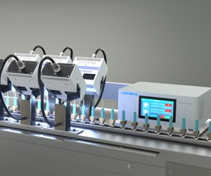
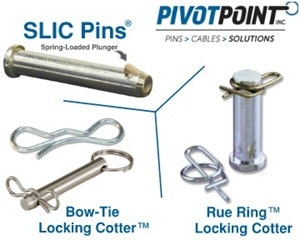

# کالبدشکافی فنی ۳ نوآوری صنعتی در طراحی ماشین‌آلات: پخت خطی پرتو UV، استانداردسازی چرخ‌دنده‌های متریک و اتصالات خودقفل‌شونده ضد ارتعاش


> **منبع اصلی:** خبرنامه بین‌المللی *Machine Design Product Spotlight* (تاریخ ۲۶ اکتبر ۲۰۲۶)  
> **کمپانی‌های همکار و اسپانسرها:** Dymax Corporation ،KHK USA (Kohara Gear) و Pivot Point Inc  
> **ترجمه تخصصی، بومی‌سازی و تحلیل مهندسی:** حسین وطن‌دوست | دپارتمان تحقیق و توسعه ماشین دیزاین (`MachineDesign.ir`)  
> **دسته‌بندی و حوزه مهندسی:** اجزای ماشین، خطوط مونتاژ پیوسته و عیب‌یابی ارتعاشات (`maintenance-diagnostics` / `general-machinery`)  

---

## ۱. مقدمه: رفع گلوگاه‌های سه‌گانه در طراحی و مونتاژ خطوط تولید صنعتی

در فرآیند طراحی خطوط تولید مدرن و ساخت ماشین‌آلات صنعتی، طراحان مکاترونیک و مدیران فنی کارخانجات به طور پیوسته با ۳ گلوگاه عملیاتی دست‌وپنجه نرم می‌کنند:
1. **طولانی بودن فرآیند پخت چسب‌ها و کوتینگ‌ها در امتداد کانوایرهای خطی:** که منجر به افزایش طول نوار نقاله‌ها، هدررفت فضا و تجمع قطعات نیمه‌ساخته (WIP) می‌شود.
2. **هزینه‌های گزاف و زمان طولانی ماشین‌کاری چرخ‌دنده‌های سفارشی:** الزام طراحان به ساخت تک‌به‌تک چرخ‌دنده‌ها در کارگاه‌های دنده‌زنی سنتی با ابزارهای فرز اختصاصی، تلرانس‌های ناپایدار و بدون گواهی‌نامه دوام خستگی.
3. **شل شدن و خطای انسانی در مونتاژ پین‌ها و اشپیل‌های متحرک:** ارتعاشات دینامیکی پیوسته در مکانیزم‌های رفت‌وبرگشتی که موجب خستگی اشپیل‌های سنتی، افتادن پین‌ها و توقف ناگهانی خط تولید (Downtime) می‌گردد.

خبرنامه تخصصی **Product Spotlight** نشریه معتبر *Machine Design* در اواخر اکتبر ۲۰۲۶، سه راهکار صنعتی ملموس را برای حل این چالش‌ها برجسته کرده است. در این تحلیل مهندسی، هر سه فناوری را کالبدشکافی کرده و کاربرد مستقیم آن‌ها را در ارتقای ماشین‌آلات و کارخانجات صنعتی بررسی می‌نماییم.

---

## ۲. سیستم‌های پخت خطی فرابنفش Dymax BlueWave® FX: پخت متمرکز با چگالی انرژی ۴.۲ وات بر سانتی‌متر مربع



در بسیاری از خطوط بسته‌بندی، مونتاژ تجهیزات پزشکی و تولید بردهای الکترونیکی، چسب‌های پایه نوری (Light-Curable Adhesives) یا عایق‌های مایع درزگیر (Form-in-Place Gaskets - FIPG) روی قطعات در حال حرکت روی کانوایر اعمال می‌شوند. لامپ‌های سنتی جیوه‌ای با تولید حرارت شدید مادون‌قرمز (IR)، مصرف توان بالا و نیاز به تهویه ازن، قطعات پلیمری نازک را دچار دفرمه‌شدگی حرارتی می‌کردند.

کمپانی آمریکایی **Dymax** در سیستم‌های **BlueWave® FX Line Emitters** (مدل‌های FX-725 و FX-1525) نسل جدیدی از گسیل‌کننده‌های خطی حالت جامد LED را ارائه کرده است:

### مشخصات و پارامترهای اپتیکی-مکانیکی:
* **چگالی تابش فرابنفش بالا (High Irradiance):** تولید تا **$4.2 \text{ W/cm}^2$** ($4200 \text{ mW/cm}^2$) توان نوری یکنواخت در تمام طول باریکه.
* **طول‌های تابش خطی استاندارد:** در دو ابعاد فعال **۷۵ میلی‌متر** (مدل FX-725) و **۱۵۰ میلی‌متر** (مدل FX-1525) با قابلیت چیدمان پشت سر هم (Modular Stacking) جهت پوشش دهانه‌های عریض‌تر.
* **طول موج‌های اختصاصی:** ارائه در ۳ طول موج تک‌رنگ باریک **365nm** ،**385nm** و **405nm**، متناسب با آغازگرهای نوری (Photoinitiators) چسب‌های اکریلیک، اپوکسی و سیلیکونی صنعتی بدون تولید اشعه مزاحم.
* **پخت سرد (Cold Cure):** حذف تابش‌های فروسرخ که اعوجاج حرارتی (Thermal Distortion) قطعات پلاستیکی و لنزهای اپتیکی حساس را به صفر می‌رساند.

### فرمول‌بندی مهندسی دوز جذب‌شده در نوار نقاله:
دوز کل انرژی دریافتی قطعه‌کار ($D$ بر حسب $\text{J/cm}^2$) در عبور از زیر گسیل‌کننده خطی با طول پنجره $L$ و سرعت خطی کانوایر $v$ از رابطه زیر محاسبه می‌شود:
$$D = \frac{I_{\text{peak}} \times L_{\text{eff}}}{v_{\text{conveyor}}}$$

با دستیابی به شدت تابش $4.2 \text{ W/cm}^2$، سرعت کانوایر می‌تواند بدون افت کیفیت پخت چسب، تا چند برابر افزایش یابد که مستقیماً نرخ خروجی قطعه در ساعت (Throughput) را بالا می‌برد.

---

## ۳. استانداردسازی چرخ‌دنده‌های متریک KHK USA: گذار از طراحی سفارشی به ۲۷,۰۰۰ قطعه آماده


شعار محوری کمپانی ژاپنی-آمریکایی **KHK Gears** یک درس بنیادین در مهندسی ماشین‌سازی است:  
> **"Stop designing your gears from scratch" (طراحی چرخ‌دنده‌های خود را از صفر متوقف کنید!)**

در فرآیند طراحی بر اساس ساخت و مونتاژ (**DFMA**)، طراحی سفارشی چرخ‌دنده برای هر گیربکس یا مکانیزم مستلزم ساخت تیغ‌فرز اختصاصی (Custom Hobs)، تنظیمات طولانی دستگاه‌های دنده‌زنی، فرآیند سخت‌کاری و اعوجاج‌های پیش‌بینی‌نشده حرارتی است که خطای گام (Pitch Error) و لقی محیطی (Backlash) را غیرقابل کنترل می‌کند.

### آرشیو ۲۷,۰۰۰ پیکربندی استاندارد متریک:
کاتالوگ استاندارد KHK بیش از **۲۷,۰۰۰ مدل آماده** را در انواع مکانیزم‌های کینماتیکی بر مبنای مدول ($m = 0.5 \text{ to } 10$) پوشش می‌دهد:

1. **چرخ‌دنده‌های ساده (Spur Gears):** با دندانه‌های صاف، سنگ‌خورده دقیق در کلاس‌های کیفی DIN/JIS برای سیستم‌های انتقال قدرت با راندمان بالا (تا ۹۸٪).
2. **چرخ‌دنده‌های مارپیچ (Helical Gears):** ضریب هم‌پوشانی دندانه بالاتر ($Contact\ Ratio > 2$)، درگیری پیوسته و کاهش چشمگیر نویز آکوستیک در دورهای بالا.
3. **چرخ‌شانه و دنده‌شانه‌ها (Gear Racks):** گزینه‌ای بی‌بدیل برای تبدیل حرکت دورانی سرووموتورها به حرکت خطی دقیق در بازوهای گانتری رباتیک و ماشین‌های CNC.
4. **چرخ‌دنده‌های مخروطی پینیون (Bevel Gears):** در هر دو فرم دندانه مستقیم و اسپیرال (مارپیچ) جهت انتقال گشتاور در زاویه ۹۰ درجه با حداقل لقی زاویه‌ای.
5. **مجموعه حلزون و چرخ‌حلزون (Worm & Worm Wheels):** دستیابی به نسبت تبدیل‌های بسیار بالا در یک مرحله ($i = 10 \text{ to } 60$) با قابلیت ذاتی قفل‌شوندگی خودکار (Self-Locking) جهت تضمین ایمنی آسانسورها و بالابرهای صنعتی.
6. **چرخ‌دنده‌های رینگی داخلی (Internal Gears):** شالوده اصلی طراحی گیربکس‌های سیاره‌ای فشرده (Planetary Gearboxes) در اتوماسیون صنعتی.

### ماتریس انتخاب مواد و متالورژی در استاندارد KHK:
| گروه ماده | گرید متالورژیکی | فرآیند عملیات حرارتی | بهترین کاربرد در خط تولید |
| :--- | :--- | :--- | :--- |
| **فولاد آلیاژی کربن‌دهی شده** | SCM435 / SCM440 (معادل AISI 4140) | کربورایزینگ، کوئیچ و تمپر + سنگ دندانه | گیربکس‌های صنعتی سنگین با تنش هرتزی بالا |
| **فولاد کربنی ساختمانی** | S45C (معادل CK45) | سخت‌کاری القایی لبه دندانه (Induction Hardened) | ماشین‌آلات عمومی، کانوایرها و درایوهای استاندارد |
| **استنلس استیل ضدزنگ** | SUS303 / SUS304 / SUS316 | آنیل و پرداخت سطحی بدون اکسید | صنایع غذایی، دارویی و شست‌وشوی بهداشتی (Washdown) |
| **پلیمرهای مهندسی** | پلی‌استال (POM) و MC نایلون | تزریق دقیق / تراشکاری با ضریب انبساط مهارشده | کاربردهای بدون روغن‌کاری (Oil-Free)، صنایع بسته‌بندی پاک |
| **برنز فسفردار** | CAC502 (فسفر برنز) | ریخته‌گری گریز از مرکز | چرخ‌حلزون در تماس با ماردون فولادی سخت جهت جلوگیری از گالینگ (Anti-Galling) |
| **چدن خاکستری** | FC200 / FC250 (معادل GG25) | ساختار پرلیتی تنش‌زدایی شده | پایه‌ها و چرخ‌های بزرگ با جذب ارتعاشات دینامیکی عالی |

---

## ۴. اتصالات هوشمند Pivot Point: پایان شکست اشپیل‌ها و خستگی در اتصالات متحرک



در اتصالات پین‌دار (Clevis Joints)، مکانیزم‌های چهارمیله‌ای (Four-Bar Linkages) و بازوهای متحرک کانوایرها، اشپیل‌های دوپایه سنتی (Split Cotter Pins) یا خارهای سنجاقی (Hairpin Clips) پاشنه آشیل خرابی‌های مکانیکی کارگاه‌ها هستند:
1. **فراموشی اپراتور در خم کردن پایه اشپیل:** که منجر به خروج ناگهانی پین تحت ارتعاش خط می‌شود.
2. **پدیده شکست خستگی سیم اشپیل:** به دلیل چرخش و ضربات متناوب رفت‌وبرگشتی.
3. **گیر کردن کابل‌ها و لباس کارگر به انتهای تیز اشپیل:** که خطرات ایمنی انسانی (ISO 12100) به همراه دارد.

کمپانی **Pivot Point** با ارائه سه خانواده اختراعی، استانداردهای جدیدی در سرعت و قابلیت اطمینان مونتاژ معرفی کرده است:

### ۱. پین‌های خودقفل‌شونده SLIC Pins® (Self-Locking Implanted Cotter):
* **مکانیزم عملکرد:** دارای یک زبانه گوه‌ای فنردار توکار (Spring-Loaded Plunger) در بدنه خود پین.
* **نصب بدون ابزار (Toolless Assembly):** هنگام عبور پین از سوراخ اتصال، زبانه با فشار دیواره به داخل فشرده شده و به محض خروج از سمت مقابل، به طور فنری باز شده و پین را قفل می‌کند.
* **صرفه‌جویی زمانی:** زمان فرآیند مونتاژ هر مفصل تا **۷۵ درصد** کاهش یافته و نیاز به پنس، انبردست یا زاویه‌سنج حذف می‌شود.
* **خطاناپذیری ساختاری (Poka-Yoke):** خطای انسانی ناشی از فراموشی اتصال اشپیل کاملاً ریشه‌کن می‌گردد.

### ۲. اشپیل‌های قفلی پاپیونی Bow-Tie Locking Cotters™:
* شکل هندسی ارگونومیک به گونه‌ای نورد شده که بال‌های مفتول فنری پس از عبور از سوراخ، دور شفت پین تابیده شده و روی لبه خود چفت (Snap-Lock) می‌شوند.
* در اثر کشیده شدن شاخه‌های کابل یا ارتعاشات شلاقی، به هیچ وجه از محل خود خارج نمی‌شوند و باز کردن آن صرفاً با فشار مستقیم شست اپراتور ممکن است.

### ۳. اشپیل‌های رینگ ۳۶۰ درجه Rue Ring™ Cotters:
* با پوشش کامل محیطی سوراخ و محیط پین، حداکثر استحکام برشی ثانویه را در برابر بارهای دینامیکی شوک‌آور (Impact Loads) در ادوات کشاورزی، خطوط سنگین نورد و فیدرهای ضربه‌ای فراهم می‌سازد.

---

## ۵. تحلیل مهندسی و پیوند با ستون‌های ۶ گانه خدمات ماشین دیزاین (`MachineDesign.ir`)

تحلیل این سه نوآوری مستقیماً در قلب ستون‌های تخصصی کسب‌وکار **ماشین دیزاین** می‌نشیند:

```
[ستون ۱: طراحی ماشین‌آلات و خطوط تولید]
└── بهره‌گیری از ۲۷,۰۰۰ چرخ‌دنده متریک استاندارد و مدولار -> کاهش ۴۰ درصدی زمان ساخت و هزینه ابزارسازی

[ستون ۲: مشاوره فنی و حل مسئله کارخانه‌ها]
└── جایگزینی اشپیل‌های سنتی با SLIC Pins و Bow-Tie -> حذف توقف‌های خط ناشی از شل‌شدن اتصالات و ارتعاشات

[ستون ۳: تحقیق و توسعه سازمانی R&D]
└── ادغام سیستم‌های پخت خطی UV LED (Dymax) -> امکان‌سنجی خطوط مونتاژ پیوسته سرعت‌بالا بدون دفرمه‌شدن قطعات
```

### چک‌لیست کاربردی برای طراحان مکانیک و مدیران فنی کارخانجات:
* [x] **پیش از دنده‌زنی سفارشی:** کاتالوگ‌های متریک DIN/JIS را بررسی کنید؛ در ۹۰٪ موارد چرخ‌دنده استاندارد با مدول استاندارد، با قیمت بسیار کمتر و دقت گام بالاتر در دسترس است.
* [x] **در مکانیزم‌های با ارتعاش فرکانس بالا:** به هیچ وجه از اشپیل‌های دوپایه بازشونده دستی روی پین‌های اصلی استفاده نکنید؛ پین‌های خودقفل‌شونده یا خارهای حلقوی بسته را در اولویت قرار دهید.
* [x] **در فرآیندهای چسب‌کاری خطوط پیوسته:** به جای تونل‌های حجیم حرارتی، به سراغ تابنده‌های متمرکز خطی UV LED با طول‌موج منطبق بر پلیمر بروید تا فضای اشغال‌شده سالن را تا یک‌سوم کاهش دهید.
