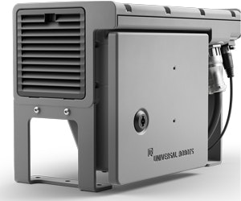
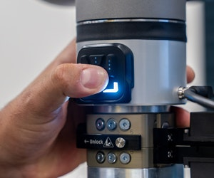
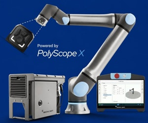
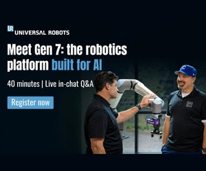
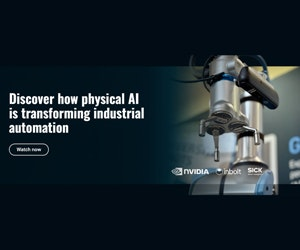
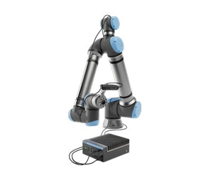
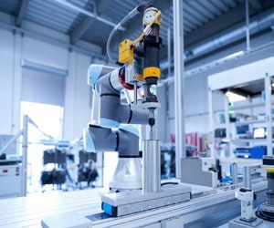
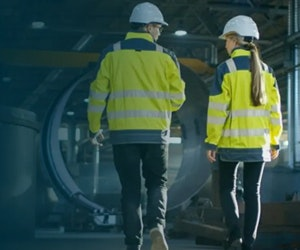

# کالبدشکافی فنی نسل هفتم ربات‌های همکار Universal Robots؛ معماری هوش مصنوعی فیزیکی در لبه و بازطراحی مکانیکی فلنج ابزار


> **منبع:** خبرنامه تخصصی *Machine Design Product Spotlight* (تاریخ ۲۲ اکتبر ۲۰۲۶)  
> **حامی و پارتنر فناور:** کمپانی دانمارکی Universal Robots (زیرمجموعه Teradyne)  
> **ترجمه تخصصی، بومی‌سازی و تحلیل مهندسی:** حسین وطن‌دوست | دپارتمان تحقیق و توسعه ماشین دیزاین (`MachineDesign.ir`)  
> **دسته‌بندی تخصصی:** رباتیک صنعتی و سلول‌های مکانیزه خطوط تولید (`robotics`)  

---


## ۱. مقدمه: تحول از کوبات‌های سنتی به پلتفرم‌های مجهز به هوش مصنوعی فیزیکی (Physical AI)

در سال‌های اخیر، ربات‌های همکار (Collaborative Robots یا Cobots) به جزئی جدایی‌ناپذیر از سلول‌های مکانیزه و کارخانجات مدرن تبدیل شده‌اند. با این حال، نسل‌های پیشین همواره با سه چالش بنیادین در کف کارگاه روبه‌رو بودند:
1. **وابستگی شدید به سیستم‌های بینایی ماشین و کامپیوترهای صنعتی خارجی (External IPCs):** که نیاز به رک‌های کنترلی مجزا و کابل‌کشی‌های حجیم داشت.
2. **اتلاف زمان اپراتور در حین برنامه‌ریزی:** الزام اپراتور به رفت‌وآمد مکرر میان میز کار و تبلت تیچ‌پندنت (Teach Pendant).
3. **خستگی مکانیکی و استهلاک کابل‌های معلق بیرونی (Cable Harnesses & Dress Packs):** که در حرکت‌های پیچیده ۶ محوره دچار پیچش، سایش و در نهایت قطعی ناگهانی سیگنال می‌شدند.

کمپانی Universal Robots در آخرین به‌روزرسانی فناوری خود (اکتبر ۲۰۲۶)، از **پلتفرم نسل هفتم (Gen 7 Platform)** رونمایی کرده است. این پلتفرم با همراهی کنترلر جدید **CB7**، بازوهای پیشرفته **g-Series** و سیستم‌عامل ماژولار **PolyScope X**، یک گام بنیادین در ادغام محاسبات هوش مصنوعی لبه (Edge AI) و بهینه‌سازی کینماتیکی برداشته است. در این مقاله، اجزای کلیدی این پلتفرم را از دیدگاه مهندسی مکانیک، مکاترونیک و بهینه‌سازی خطوط تولید کالبدشکافی می‌کنیم.

---

## ۲. کنترلر نسل جدید CB7: جهش ۴۰ درصدی پردازش در فضایی ۳۰ درصد فشرده‌تر



یکی از گلوگاه‌های اصلی در اضافه کردن بینایی ماشین پیشرفته (AI Vision) و مدل‌های تصمیم‌گیری بلادرنگ به ربات‌ها، کمبود توان پردازشی در جعبه‌های کنترل (Control Boxes) سنتی بود. کارخانه‌ها معمولاً ناچار بودند یک کامپیوتر صنعتی گران‌قیمت مجهز به پردازنده گرافیکی (GPU) را در تابلو برق نصب کنند که علاوه بر افزایش مصرف انرژی، فضای باارزش خط تولید را اشغال می‌کرد.

### مشخصات و نوآوری‌های مهندسی کنترلر CB7:
* **۴۰ درصد افزایش توان پردازشی خام:** پردازنده‌های ارتقایافته امکان اجرای شبکه‌های عصبی پیچیده (Convolutional Neural Networks) و الگوریتم‌های ره‌گیری سه‌بعدی را به صورت بومی فراهم می‌کنند.
* **۳۰ درصد کاهش ابعاد تابلو (Footprint Reduction):** طراحی حرارتی بهینه‌تر و چگالی قطعات بالاتر، امکان جاگذاری راحت این کنترلر را در فضاهای فشرده زیر کانوایرها یا داخل سلول‌های ماشین‌ابزار مهیا ساخته است.
* **سیستم‌عامل متن‌باز PolyScope X:** پلتفرم نرم‌افزاری جدید UR که مبتنی بر میکروسرویس‌ها و کانتینرهای نرم‌افزاری است، به توسعه‌دهندگان اجازه می‌دهد مدل‌های هوش مصنوعی فیزیکی (Physical AI) را بدون هیچ‌گونه لایه واسط روی خود کنترلر ران کنند.

```
[معماری سنتی] : دوربین -> کابل بلند -> کامپیوتر خارجی IPC (پردازش سنگین) -> کابل شبکه -> کنترلر کوبات -> بازو
[معماری نسل ۷] : سنسور/دوربین -> فلنج مچ -> پردازش مستقیم روی کنترلر CB7 (Edge AI) -> بازخورد بلادرنگ به مفصل
```

این تغییر ساختاری، تاخیر حلقه کنترل (Control Loop Latency) را از مرتبه ده‌ها میلی‌ثانیه به زیر چند میلی‌ثانیه کاهش داده و امکان تصحیح بلادرنگ مسیر حرکت در برابر جابه‌جایی پیش‌بینی‌نشده قطعات را فراهم می‌کند.

---

## ۳. پنل هوشمند مچ SP7 Smart Panel: ارگونومی و حذف رفت‌وآمدهای اتلافی



در مهندسی متدها و زمان‌سنجی تولید (Time and Motion Study)، یکی از بزرگ‌ترین عوامل اتلاف زمان در راه‌اندازی سلول رباتیک، جابه‌جایی مکرر اپراتور بین ابزار انتهایی (End-Effector) و تبلت برنامه‌ریزی (Teach Pendant) است. وقتی اپراتور بخواهد یک مسیر جوشکاری میلی‌متری یا نقطه برداشتن قطعه (Pick Point) را تنظیم کند، باید دائماً به صفحه نمایش نگاه کند، کلیدها را بزند، چند قدم بردارد و موقعیت قطعه را با چشم چک کند.

### دستاورد پنل هوشمند SP7:
* **موقعیت قرارگیری:** اینترفیس لمسی و کلیدهای فیزیکی صنعتی مستقیماً روی آخرین مفصل مچ ربات (Wrist Joint) ادغام شده‌اند.
* **برنامه‌ریزی نقطه صفر (Zero-Distance Path Teaching):** اپراتور دست خود را روی ابزار می‌گذارد، وضعیت ابزار را با دستانش تغییر می‌دهد (Free-Drive) و همان‌جا با فشردن کلیدهای تعبیه‌شده روی مچ، نقطه را ثبت (Teach)، مسیر را تایید و پارامترها را تنظیم می‌کند.
* **صرفه‌جویی در زمان آماده‌سازی:** در سلول‌های کاری بزرگ یا سلول‌های محصور (مانند دستگاه‌های تراش و فرز CNC)، زمان تنظیم اولیه (Setup Time) تا ۵۰٪ کاهش می‌یابد.

---

## ۴. فلنج ابزار سری g: حذف ریسک گیرپاژ و خستگی کابل‌ها (Cable Fatigue)



از دیدگاه قابلیت اطمینان مکانیکی (Reliability Engineering)، کابل‌های بیرونی متصل به گریپر یا اسپیندل (Dress Packs) یکی از آسیب‌پذیرترین قطعات متحرک در ربات‌ها هستند. با تکرار چند صد هزار سیکل چرخش در مچ ۳ ربات (Wrist 3)، پدیده‌های زیر رخ می‌دهند:
1. **خستگی ناشی از پیچش و خمش مکرر (Torsional & Bending Fatigue):** که منجر به شکستن رشته‌های مسی داخل کابل و قطعی‌های متناوب مرموز در سنسورها می‌شود.
2. **گیر کردن به فیکسچرها و سازه (Cable Snagging):** کابل‌های آویزان به راحتی در هنگام چرخش سریع به گوشه فیکسچر یا قطعه‌کار گیر کرده و باعث توقف اضطراری (E-Stop) یا شکستن اتصالات می‌شوند.

### راهکار بازوهای سری g پلتفرم نسل ۷:
* **مسیریابی کاملاً داخلی از درون مچ توخالی (Hollow Wrist Flange):** خطوط توان الکتریکی، باس داده با سرعت گیگابیت، و کانال‌های ایمنی دوکاناله به صورت یکپارچه از داخل شفت مفصل عبور داده شده‌اند.
* **رابط استاندارد اتصال ابزار:** ابزارهای انتهای خط، گریپرهای پنیوماتیک/الکتریکی و دوربین‌های بازرسی مستقیماً به فلنج پیچ شده و کانکتور یکپارچه آن‌ها قفل می‌شود.
* **نتیجه صنعتی:** نرخ توقف خط ناشی از خرابی کابل‌کشی ابزار به صفر میل می‌کند و امکان چرخش مداوم ابزار بدون محدودیت زاویه‌ای کابل فراهم می‌شود.

---

## ۵. مقیاس‌پذیری هوش مصنوعی فیزیکی در خطوط موجود؛ همکاری استراتژیک با NVIDIA

````carousel

<!-- slide -->

````

یکی از ترس‌های بزرگ مدیران کارخانجات صنعتی در هنگام مواجهه با واژه «هوش مصنوعی» این است که پیاده‌سازی آن نیازمند دور ریختن ماشین‌آلات فعلی، خواب طولانی خط و هزینه‌های عمرانی سرسام‌آور است. 

در وبینار مشترک Universal Robots و NVIDIA، متدولوژی **«هوش مصنوعی بدون بازطراحی سالن (Zero-Overhaul AI Integration)»** معرفی شده است:
* **شبیه‌سازی با دوقلوی دیجیتال (Digital Twin):** با استفاده از پلتفرم **NVIDIA Isaac & Omniverse**، تمام سناریوهای حرکتی ربات، برخوردها و پردازش تصویر با داده‌های مصنوعی (Synthetic Data) در محیط شبیه‌سازی آموزش داده می‌شوند.
* **استقرار سریع (Rapid Sim2Real Transfer):** الگوریتم‌های هوش مصنوعی آموزش‌دیده مستقیماً به کنترلر CB7 منتقل می‌شوند، بدون اینکه حتی ۱ ساعت تولید خط متوقف شود.
* **تطبیق‌پذیری فیزیکی:** ربات می‌تواند قطعاتی را که جهت‌گیری نامنظم دارند (Random Bin Picking) بدون نیاز به کاسه تغذیه‌کننده (Vibratory Bowl Feeder) گران‌قیمت بردارد.

---

## ۶. بینایی ماشین یکپارچه و کاربردهای میدانی در کارخانجات

````carousel

<!-- slide -->

````

معماری یکپارچه این نسل، بازوهای روباتیک را به سامانه‌های چندمنظوره تبدیل کرده است:

| کاربرد صنعتی | چالش سنتی خطوط | راهکار پلتفرم Gen 7 با بینایی هوشمند |
| :--- | :--- | :--- |
| **تغذیه ماشین‌آلات (CNC Tending)** | خطای جاگذاری دستی، خطر برخورد، زمان مرده اپراتور | جاگذاری صدم‌میلی‌متری قطعه با تکیه بر بینایی لبه و حذف کابل‌های مزاحم در فضای بسته دستگاه |
| **جوشکاری رباتیک (MIG/TIG Welding)** | نیاز به مهارت بالای برنامه‌ریزی جوش‌های قوسی پیچیده | تعریف نقطه جوش و ره‌گیری درز جوش (Seam Tracking) با دکمه‌های مچ SP7 در محل مشعل |
| **پالتایزینگ و انتهای خط (Palletizing)** | خستگی مفرط کارگران و تنوع بالای ابعاد کارتن‌ها | چیدمان هوشمند با تشخیص ارتفاع کارتن، بدون نیاز به سنسورهای فوتوالکتریک متعدد روی بازو |
| **کنترل کیفی و بازرسی ابعادی (QC Inspection)** | خطای دید انسانی و افت تمرکز در شیفت‌های شب | اسکن ۳۶۰ درجه قطعات صنعتی با دوربین نصب‌شده روی فلنج و گزارش فوری مغایرت‌های مونتاژی |

---

## ۷. متدولوژی Line Walk: استراتژی عیب‌یابی و تدوین نقشه راه اتوماسیون



کمپانی Universal Robots برای کارخانجاتی که هنوز نمی‌دانند اتوماسیون رباتیک را از کدام نقطه شروع کنند، متد **Line Walk (ارزیابی میدانی گام‌به‌گام خط)** را پیشنهاد می‌دهد. 

این فرآیند دقیقاً با رویکرد مهندسی **ماشین دیزاین (MachineDesign.ir)** در ستون‌های خدماتی ۲ و ۳ مطابقت دارد:
1. **پیمایش کارگاهی (Line Walkthrough):** بررسی فیزیکی ایستگاه‌های کاری که گلوگاه تولید هستند یا حوادث ارگونومیک در آن‌ها بالاست.
2. **محاسبه نرخ بازگشت سرمایه (ROI Analysis):** تخمین زمان بازگشت سرمایه بر اساس نرخ خرابی قطعه، دستمزد اپراتور و زمان سیکل کاری (Cycle Time).
3. **امکان‌سنجی فضا و ایمنی بر اساس استانداردهای ISO 10218 و ISO/TS 15066:** بررسی اینکه آیا ربات بدون حصار محافظ (Fenceless) می‌تواند در کنار کارگران کار کند یا نیاز به اسکنرهای ایمنی لیزری دارد.

---

## ۸. جمع‌بندی مهندسی و چشم‌انداز پیاده‌سازی در صنایع داخلی

پلتفرم Gen 7 کمپانی Universal Robots نشان می‌دهد که آینده رباتیک صنعتی نه در سرعت یا باربرداری‌های نجومی، بلکه در **هوشمندسازی لبه، ساده‌سازی تعامل انسان و ربات (HMI)، و حذف نقاط خرابی مکانیکی (نظیر کابل‌های بیرونی)** رقم می‌خورد.

برای مهندسان طراح ماشین‌آلات، سازندگان خطوط تولید، و مدیران کارخانجات در ایران:
* استفاده از ماژول‌های مجهز به هوش مصنوعی لبه، نیاز به طراحی تابلوبرق‌های حجیم مجزا را از بین می‌برد.
* انتخاب فلنج‌های استاندارد با کابل‌کشی توخالی (Hollow Wrist)، طول عمر کاری ابزارها را به شدت افزایش داده و از توقف‌های ناگهانی خطوط جلوگیری می‌کند.
* پیاده‌سازی سلول‌های همکار به شیوه اصولی، هزینه‌های استهلاک را مهار کرده و امکان رقابت کیفی در بازارهای صادراتی را هموار می‌سازد.

---

*دپارتمان مهندسی ماشین دیزاین آمادگی دارد خدمات مشاوره فنی، طراحی سلول‌های مکانیزه و کارشناسی خرید و اجرای پروژه‌های اتوماسیون رباتیک را در خطوط تولید سراسر کشور ارائه دهد.*
